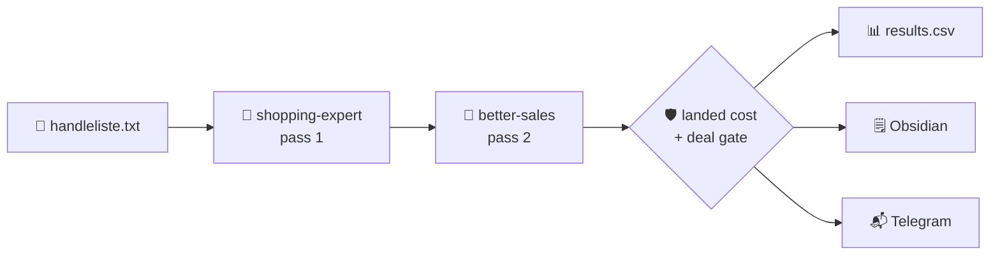

<div align="center">

# 🛒 priceskeptic

**Your shopping list, hunted while you sleep.**

[](go.mod) [](docs/STATE-MACHINES.md#verification) [](#quick-start) [](#license--contact)

</div>

## 🔭 At a glance

**priceskeptic** turns `handleliste.txt` into a ranked shortlist of **verified offers delivered to Norway**. It runs the OpenCode `shopping-expert` agent twice per item, checks the real landed cost, drops fake discounts, and writes `results.csv`, an Obsidian table, and an optional Telegram digest.

> **Why it's different:** offers are compared as landed cost in NOK, not as search snippets. Unknown shipping is called out, never guessed — and the cheapest buyable offer is always shown, even when it isn't on sale.



## ✨ Core features

| | Capability | What it does |
| :--: | --- | --- |
| 🔎 | **Two-pass search** | Pass 1 finds offers; pass 2 hunts better sales in the same OpenCode session. A failed pass 2 still keeps pass 1. |
| 🇳🇴 | **Real landed cost** | Shipping, VAT, import, and handling to your postal code. Unknown shipping is `NaN`, never a fake `0`. |
| 🛡️ | **Deal gate** | Drops regular prices without discount evidence; Trustpilot breaks ties or filters weak stores. The cheapest buyable offer is always kept. |
| ⏰ | **Set and forget** | Runs at startup, then 10:00 and 22:00 local. One run at a time, with an optional Telegram digest. |

## 🧰 Tech stack


## 🚀 Quick start

> **Prereqs:** Go 1.27.3+ and [`opencode`](https://opencode.ai) on `PATH`. The bundled `shopping-expert` skill does the searching.

```sh
# 1. Clone
git clone https://github.com/0xViva/priceskeptic.git && cd priceskeptic

# 2. Add your items
$EDITOR handleliste.txt

# 3. Build, start, and schedule
./scripts/start.sh

# 4. Hunt on demand (the startup run is automatic)
curl -X POST http://127.0.0.1:8080/search
```

Results land in **`results.csv`** and the configured **Obsidian** note. Check progress with `curl -s localhost:8080/status`; stop with `./scripts/stop.sh`.

**Optional extras**

```sh
# Amazon delivery checks
npm install --prefix tools && (cd tools && npx playwright install chromium)

# Telegram digest (then restart the service)
printf 'PRICESKEPTIC_TELEGRAM_TOKEN=...\nPRICESKEPTIC_TELEGRAM_CHAT=...\n' > .run/telegram.env
```

## License & contact

**No license declared** — treat this repository as all rights reserved until one is added.

Maintained by [@0xViva](https://github.com/0xViva) · [Open an issue](https://github.com/0xViva/priceskeptic/issues) · [Full reference](docs/REFERENCE.md) · [State machines](docs/STATE-MACHINES.md)

---

<sub>Built for the Norwegian market · Prices in NOK · [Roadmap](docs/TODOS.md)</sub>
